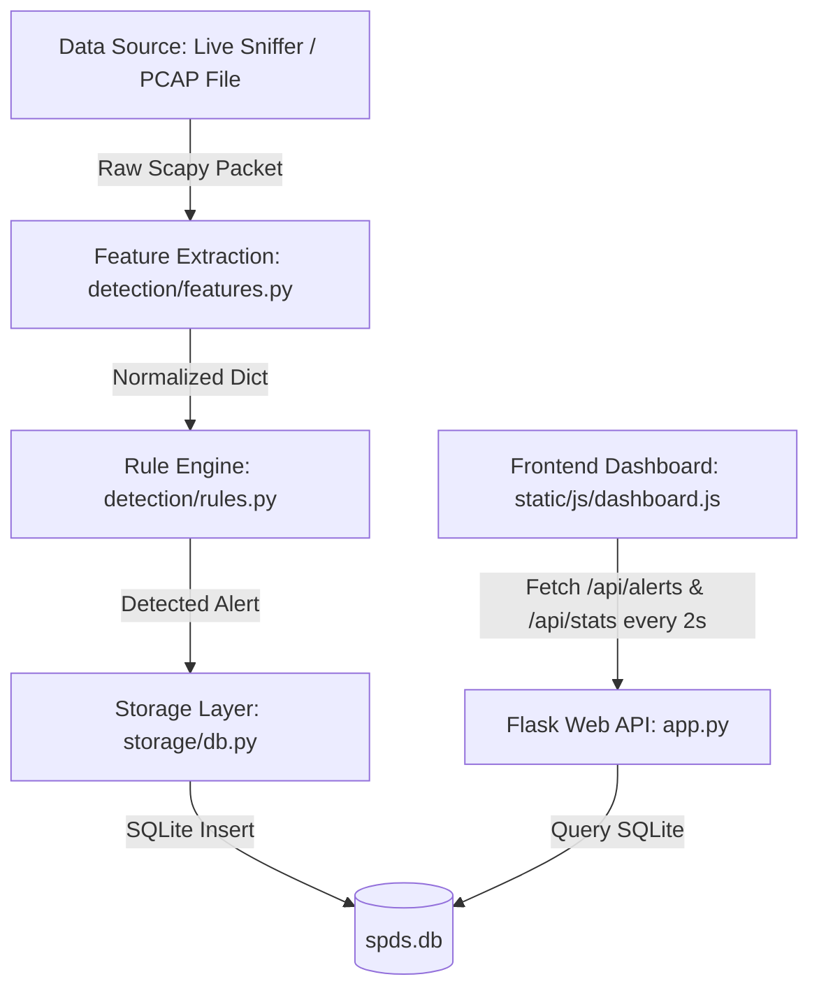

# Suspicious Packet Detection System (SPDS) — Full System Documentation & Line-by-Line Annotated Code Guide

---

## 📖 Table of Contents
1. [System Architecture & Workflow Overview](#1-system-architecture--workflow-overview)
2. [Component Breakdown & Line-by-Line Code Annotations](#2-component-breakdown--line-by-line-code-annotations)
   - [A. Web Application Controller (`app.py`)](#a-web-application-controller-apppy)
   - [B. Feature Extractor (`detection/features.py`)](#b-feature-extractor-detectionfeaturespy)
   - [C. Stateful Rule Engine (`detection/rules.py`)](#c-stateful-rule-engine-detectionrulespy)
   - [D. Live Packet Sniffer (`capture/sniffer.py`)](#d-live-packet-sniffer-capturesnifferpy)
   - [E. PCAP File Processor (`capture/pcap_reader.py`)](#e-pcap-file-processor-capturepcap_readerpy)
   - [F. Database Storage & Statistics (`storage/db.py`)](#f-database-storage--statistics-storagedbpy)
   - [G. Dashboard Client Logic (`static/js/dashboard.js`)](#g-dashboard-client-logic-staticjsdashboardjs)
3. [Detection Rules & Risk Classification Matrix](#3-detection-rules--risk-classification-matrix)

---

## 1. System Architecture & Workflow Overview

The **Suspicious Packet Detection System (SPDS)** is designed to perform real-time network intrusion monitoring and PCAP forensic analysis. It follows a decoupled 4-stage pipeline architecture:



### End-to-End Workflow:
1. **Packet Capture:** Traffic is ingested either live via Scapy in a background daemon thread (`sniffer.py`) or offline by parsing uploaded PCAP trace files (`pcap_reader.py`).
2. **Feature Extraction:** Raw network packets are parsed into normalized Python dictionaries (`features.py`) containing `src_ip`, `dst_ip`, `src_port`, `dst_port`, `protocol`, `size`, `tcp_flags`, and `timestamp`. Malformed or non-IP packets are safely ignored.
3. **Sliding-Window Rule Analysis:** Extracted feature dictionaries enter the `RuleEngine` (`rules.py`). Using sliding temporal windows (`defaultdict(deque)`), packets are analyzed against 6 threat detection rules. Alerts are passed through a cooldown filter to prevent duplicate alert spam.
4. **Database Persistence:** Detected threats are saved to `spds.db` via `storage/db.py` with timestamping and risk classification (`Low`, `Medium`, `High`, `Critical`).
5. **Real-Time Visualization:** The single-page dashboard (`templates/index.html` & `dashboard.js`) polls Flask API endpoints (`/api/alerts` and `/api/stats`) every 2 seconds to update metrics cards, Chart.js trend graphs, and color-coded table rows without requiring a page refresh.

---

## 2. Component Breakdown & Line-by-Line Code Annotations

---

### A. Web Application Controller (`app.py`)

This file initializes the Flask application server, defines the file upload limits, and exposes RESTful API endpoints for the dashboard frontend.

```python
import os  # System module for operating system and file path operations
from flask import Flask, render_template, request, jsonify  # Web framework components for routing, HTML rendering, request handling, and JSON responses
from werkzeug.utils import secure_filename  # Security utility to sanitize uploaded file names
from capture.pcap_reader import process_pcap_file  # Import function to process PCAP file traces
from capture.sniffer import sniffer  # Import global LiveSniffer singleton instance
from storage.db import init_db, get_recent_alerts, get_summary_stats, clear_alerts  # Database helper functions

app = Flask(__name__)  # Initialize Flask application instance

# Configure Uploads directory
BASE_DIR = os.path.dirname(os.path.abspath(__file__))  # Get absolute directory path of app.py
UPLOAD_FOLDER = os.path.join(BASE_DIR, 'uploads')  # Define directory path where uploaded PCAP files will land
os.makedirs(UPLOAD_FOLDER, exist_ok=True)  # Create uploads directory if it does not already exist
app.config['UPLOAD_FOLDER'] = UPLOAD_FOLDER  # Set upload folder in Flask application configuration
app.config['MAX_CONTENT_LENGTH'] = 50 * 1024 * 1024  # Limit maximum HTTP request size to 50 MB to prevent memory exhaustion

# Ensure database is initialized
init_db()  # Create SQLite database and alerts table at startup if not present

@app.route('/')  # Define root URL route
def index():
    return render_template('index.html')  # Render and return the main HTML dashboard template

# ==========================================
# PCAP Upload Routes
# ==========================================

@app.route('/api/upload_pcap', methods=['POST'])  # Endpoint to handle multipart PCAP file uploads
def upload_pcap():
    if 'file' not in request.files:  # Check if request payload contains a file object
        return jsonify({'success': False, 'error': 'No file field in request'}), 400  # Return HTTP 400 error if missing

    file = request.files['file']  # Extract file object from request
    if file.filename == '':  # Check if user submitted an empty filename
        return jsonify({'success': False, 'error': 'No file selected'}), 400  # Return HTTP 400 error

    filename = secure_filename(file.filename)  # Sanitize filename to prevent directory traversal attacks
    if not filename:  # If sanitized filename becomes empty, fallback to default name
        filename = "uploaded.pcap"

    filepath = os.path.join(app.config['UPLOAD_FOLDER'], filename)  # Build full destination path for uploaded file
    try:
        file.save(filepath)  # Save uploaded file contents to disk
    except Exception as e:  # Catch disk write or permission errors
        return jsonify({'success': False, 'error': f'Failed to save uploaded file: {str(e)}'}), 500  # Return HTTP 500 error

    # Process PCAP file through detection engine and DB
    summary = process_pcap_file(filepath)  # Run PCAP file through feature extraction, rules engine, and DB storage
    return jsonify(summary)  # Return detection summary JSON payload to client

# ==========================================
# Live Capture Routes
# ==========================================

@app.route('/api/interfaces', methods=['GET'])  # Endpoint to list available host network interfaces
def list_interfaces():
    ifaces = sniffer.get_interfaces()  # Query Scapy for network interfaces
    return jsonify({'success': True, 'interfaces': ifaces})  # Return interfaces list as JSON

@app.route('/api/start_capture', methods=['POST'])  # Endpoint to start live packet sniffing
def start_capture():
    data = request.get_json(silent=True) or request.form  # Read request JSON body or fallback to form data
    interface = data.get('interface')  # Get selected interface ID

    if not interface:  # If interface wasn't specified in request
        ifaces = sniffer.get_interfaces()  # Fetch available interface list
        if ifaces:
            interface = ifaces[0]['id']  # Fall back to first available interface
        else:
            interface = 'default'  # Fall back to default interface keyword

    res = sniffer.start_sniffing(interface)  # Call sniffer instance to launch background capture thread
    status_code = 200 if res.get('success') else 400  # Set HTTP status code 200 on success, 400 on failure
    return jsonify(res), status_code  # Return response payload and HTTP status code

@app.route('/api/stop_capture', methods=['POST'])  # Endpoint to stop live packet sniffing
def stop_capture():
    res = sniffer.stop_sniffing()  # Signal background sniffer thread to terminate
    status_code = 200 if res.get('success') else 400  # Set HTTP status code
    return jsonify(res), status_code  # Return result JSON

@app.route('/api/capture_status', methods=['GET'])  # Endpoint to query current sniffer status
def capture_status():
    status = sniffer.get_status()  # Fetch running state, packet count, alert count, and error status
    return jsonify({'success': True, 'status': status})  # Return status JSON payload

# ==========================================
# Alerts & Database Routes
# ==========================================

@app.route('/api/alerts', methods=['GET'])  # Endpoint to fetch recent detected alerts from database
def get_alerts():
    limit = request.args.get('limit', default=50, type=int)  # Parse optional 'limit' query parameter (default 50)
    alerts = get_recent_alerts(limit=limit)  # Query SQLite database for recent alert rows
    return jsonify({'success': True, 'count': len(alerts), 'alerts': alerts})  # Return alerts list as JSON

@app.route('/api/stats', methods=['GET'])  # Endpoint to fetch aggregated summary metrics
def get_stats():
    stats = get_summary_stats()  # Get alert counts, risk level breakdown, and top source IPs
    status = sniffer.get_status()  # Get current live sniffer thread status
    stats['live_capture'] = status  # Attach live capture status to summary stats object
    return jsonify({'success': True, 'stats': stats})  # Return aggregated stats JSON

@app.route('/api/clear_db', methods=['POST'])  # Endpoint to reset/clear database records
def clear_db_route():
    clear_alerts()  # Execute DELETE query on alerts table in SQLite
    return jsonify({'success': True, 'message': 'Database cleared successfully'})  # Return confirmation JSON

if __name__ == '__main__':  # Main execution block
    app.run(host='127.0.0.1', port=5000, debug=True)  # Start Flask development server on localhost port 5000
```

---

### B. Feature Extractor (`detection/features.py`)

Parses raw Scapy packets or synthetic inputs into standard key-value feature dictionaries.

```python
import time  # Module for retrieving system timestamp
from scapy.layers.inet import IP, TCP, UDP, ICMP  # Import IPv4 and transport protocol layers from Scapy
from scapy.layers.inet6 import IPv6  # Import IPv6 layer from Scapy

def extract_features(packet):
    """
    Extracts core network features from a Scapy packet or feature dict.
    Returns a dictionary with src_ip, dst_ip, src_port, dst_port, protocol, size, tcp_flags, timestamp.
    Returns None if packet is malformed or non-IP.
    """
    if packet is None:  # If input packet is None
        return None  # Safely return None

    # If already a dictionary (e.g. synthetic test input), return normalized dict or None if invalid
    if isinstance(packet, dict):  # Check if input is a Python dictionary
        required_keys = {'src_ip', 'dst_ip', 'src_port', 'dst_port', 'protocol', 'size', 'tcp_flags', 'timestamp'}  # Required fields set
        if not required_keys.issubset(packet.keys()):  # Check if all required keys exist in dictionary
            return None  # Return None if any key is missing
        return packet  # Return input dictionary as valid features

    try:  # Wrap Scapy packet parsing in try block to catch malformed packet exceptions
        features = {  # Initialize default feature dictionary template
            'src_ip': None,  # Source IP address placeholder
            'dst_ip': None,  # Destination IP address placeholder
            'src_port': None,  # Source Port number placeholder
            'dst_port': None,  # Destination Port number placeholder
            'protocol': 'OTHER',  # Default protocol label
            'size': len(packet),  # Calculate raw packet byte length
            'tcp_flags': None,  # TCP flags string placeholder
            'timestamp': float(getattr(packet, 'time', time.time()))  # Extract packet capture time or use current system time
        }

        # IP layer parsing
        if packet.haslayer(IP):  # Check if packet contains IPv4 layer
            features['src_ip'] = packet[IP].src  # Extract IPv4 source address
            features['dst_ip'] = packet[IP].dst  # Extract IPv4 destination address
        elif packet.haslayer(IPv6):  # Check if packet contains IPv6 layer
            features['src_ip'] = packet[IPv6].src  # Extract IPv6 source address
            features['dst_ip'] = packet[IPv6].dst  # Extract IPv6 destination address
        else:
            # Non-IP packet (e.g. ARP, raw L2)
            return None  # Ignore non-IP packets safely

        # Transport layer parsing
        if packet.haslayer(TCP):  # Check if packet contains TCP header
            features['protocol'] = 'TCP'  # Set protocol label to TCP
            features['src_port'] = int(packet[TCP].sport)  # Extract TCP source port
            features['dst_port'] = int(packet[TCP].dport)  # Extract TCP destination port
            features['tcp_flags'] = str(packet[TCP].flags)  # Extract TCP flag string (e.g. 'S', 'A', 'F')
        elif packet.haslayer(UDP):  # Check if packet contains UDP header
            features['protocol'] = 'UDP'  # Set protocol label to UDP
            features['src_port'] = int(packet[UDP].sport)  # Extract UDP source port
            features['dst_port'] = int(packet[UDP].dport)  # Extract UDP destination port
        elif packet.haslayer(ICMP):  # Check if packet contains ICMP header
            features['protocol'] = 'ICMP'  # Set protocol label to ICMP

        return features  # Return extracted features dictionary
    except Exception:  # Handle malformed packet read errors gracefully
        # Catch any unexpected malformed packet error and return None safely
        return None  # Return None on error without crashing application
```

---

### C. Stateful Rule Engine (`detection/rules.py`)

Contains the temporal detection logic, sliding windows (`deque`), threshold constants, alert suppression cooldowns, and risk level classifications.

```python
import time  # Module for tracking alert timestamps and cooldowns
from collections import defaultdict, deque  # Import defaultdict and deque for efficient double-ended sliding window queues

# ==========================================
# Detection Thresholds & Rule Configuration
# ==========================================

# Port Scan rule configuration
PORT_SCAN_WINDOW_SEC = 5.0  # Sliding window duration in seconds for Port Scan detection
PORT_SCAN_THRESHOLD = 10  # Maximum allowed distinct destination ports per source IP before alerting

# SYN Flood rule configuration
SYN_FLOOD_WINDOW_SEC = 5.0  # Sliding window duration in seconds for SYN Flood detection
SYN_FLOOD_THRESHOLD = 20  # Maximum allowed TCP SYN packets per source IP before alerting

# ICMP Flood rule configuration
ICMP_FLOOD_WINDOW_SEC = 5.0  # Sliding window duration in seconds for ICMP Flood detection
ICMP_FLOOD_THRESHOLD = 15  # Maximum allowed ICMP packets per source IP before alerting

# Packet Burst rule configuration
PACKET_BURST_WINDOW_SEC = 2.0  # Sliding window duration in seconds for Packet Burst detection
PACKET_BURST_THRESHOLD = 30  # Maximum allowed total packets per source IP before alerting

# Abnormally Large Packet Anomaly threshold (bytes)
LARGE_PACKET_THRESHOLD = 1500  # Frame size threshold in bytes (exceeding standard MTU size)

# Suspicious Ports list
SUSPICIOUS_PORTS = {  # Set of well-known vulnerable or exploit-associated port numbers
    21,    # FTP
    23,    # Telnet
    135,   # RPC
    139,   # NetBIOS
    445,   # SMB
    1433,  # MSSQL
    3389,  # RDP
    4444,  # Metasploit default listener
    5900,  # VNC
    6667   # IRC
}

# Cooldown period (in seconds) per (src_ip, alert_type) to prevent spamming duplicate alerts
ALERT_COOLDOWN_SEC = 3.0  # Minimum seconds required between duplicate alerts for the same source IP & attack type


class RuleEngine:
    """
    Stateful Detection Rule Engine using sliding windows for traffic analysis.
    """
    def __init__(self):
        # Sliding windows keyed by src_ip
        self.port_scan_history = defaultdict(deque)     # Double-ended queue storing (timestamp, dst_port) tuples per IP
        self.syn_flood_history = defaultdict(deque)     # Double-ended queue storing SYN packet timestamps per IP
        self.icmp_flood_history = defaultdict(deque)    # Double-ended queue storing ICMP packet timestamps per IP
        self.packet_burst_history = defaultdict(deque)  # Double-ended queue storing overall packet timestamps per IP

        # Cooldown tracking: (src_ip, alert_type) -> last_alert_timestamp
        self.last_alert_time = {}  # Dictionary mapping (src_ip, alert_type) tuple to last triggered epoch timestamp

    def _should_suppress_alert(self, src_ip, alert_type, now):
        """Returns True if an alert of alert_type for src_ip occurred within ALERT_COOLDOWN_SEC."""
        key = (src_ip, alert_type)  # Form lookup key tuple
        last_time = self.last_alert_time.get(key, 0)  # Get last alert timestamp for this IP and alert type
        if now - last_time < ALERT_COOLDOWN_SEC:  # Check if elapsed time is less than cooldown window
            return True  # Suppress duplicate alert
        self.last_alert_time[key] = now  # Update last alert timestamp to current time
        return False  # Allow alert to trigger

    def reset_state(self):
        """Resets all sliding windows and alert histories (useful for testing)."""
        self.port_scan_history.clear()  # Clear port scan history queues
        self.syn_flood_history.clear()  # Clear SYN flood history queues
        self.icmp_flood_history.clear()  # Clear ICMP flood history queues
        self.packet_burst_history.clear()  # Clear packet burst history queues
        self.last_alert_time.clear()  # Clear alert cooldown timestamps

    def analyze(self, features):
        """
        Analyzes packet features against all detection rules.
        Returns a list of alert dictionaries (empty list if no rules triggered or if features is None).
        """
        if not features or not isinstance(features, dict):  # Validate that features dictionary exists
            return []  # Return empty list if invalid

        src_ip = features.get('src_ip')  # Extract source IP
        dst_ip = features.get('dst_ip')  # Extract destination IP
        src_port = features.get('src_port')  # Extract source port
        dst_port = features.get('dst_port')  # Extract destination port
        protocol = features.get('protocol')  # Extract protocol
        size = features.get('size', 0)  # Extract packet byte size
        tcp_flags = features.get('tcp_flags') or ''  # Extract TCP flags string
        now = features.get('timestamp', time.time())  # Extract packet timestamp

        if not src_ip:  # Ensure source IP exists
            return []  # Return empty list if source IP missing

        alerts = []  # Initialize list to collect triggered alert dicts

        # -----------------------------------------------------------
        # Rule 1: Suspicious Port
        # -----------------------------------------------------------
        matched_port = None  # Placeholder for matched risky port
        if dst_port in SUSPICIOUS_PORTS:  # Check if destination port is in suspicious list
            matched_port = dst_port  # Record matched destination port
        elif src_port in SUSPICIOUS_PORTS:  # Check if source port is in suspicious list
            matched_port = src_port  # Record matched source port

        if matched_port is not None:  # If a risky port match was found
            alert_type = 'Suspicious Port'  # Set alert type string
            if not self._should_suppress_alert(src_ip, alert_type, now):  # Check cooldown suppression
                alerts.append({  # Append alert dictionary
                    'type': alert_type,  # Alert classification name
                    'risk_level': 'Medium',  # Risk classification level
                    'src_ip': src_ip,  # Source IP address
                    'dst_ip': dst_ip,  # Destination IP address
                    'details': f"Traffic detected on suspicious port {matched_port} ({protocol})"  # Descriptive detail string
                })

        # -----------------------------------------------------------
        # Rule 2: Port Scan (same src_ip hitting N distinct dst_ports)
        # -----------------------------------------------------------
        if dst_port is not None:  # Ensure packet has a destination port
            q = self.port_scan_history[src_ip]  # Fetch port scan sliding queue for this source IP
            q.append((now, dst_port))  # Append current timestamp and destination port tuple to queue
            while q and now - q[0][0] > PORT_SCAN_WINDOW_SEC:  # Remove entries older than window duration (5.0s)
                q.popleft()  # Pop oldest tuple from left of queue
            
            distinct_ports = {port for ts, port in q}  # Compute set of unique destination ports in queue
            if len(distinct_ports) > PORT_SCAN_THRESHOLD:  # Check if unique ports count exceeds threshold (10)
                alert_type = 'Port Scan'  # Set alert type string
                if not self._should_suppress_alert(src_ip, alert_type, now):  # Check cooldown suppression
                    alerts.append({  # Append alert dictionary
                        'type': alert_type,  # Alert classification name
                        'risk_level': 'High',  # Risk classification level
                        'src_ip': src_ip,  # Source IP address
                        'dst_ip': dst_ip,  # Destination IP address
                        'details': f"Source IP hit {len(distinct_ports)} distinct ports within {PORT_SCAN_WINDOW_SEC}s"  # Detail string
                    })

        # -----------------------------------------------------------
        # Rule 3: SYN Flood (more than N TCP SYN packets)
        # -----------------------------------------------------------
        if protocol == 'TCP' and 'S' in tcp_flags and 'A' not in tcp_flags:  # Check for TCP SYN packet (SYN flag present, ACK flag absent)
            q = self.syn_flood_history[src_ip]  # Fetch SYN flood sliding queue for this source IP
            q.append(now)  # Append packet timestamp to queue
            while q and now - q[0] > SYN_FLOOD_WINDOW_SEC:  # Remove timestamps older than window duration (5.0s)
                q.popleft()  # Pop oldest timestamp from left of queue

            if len(q) > SYN_FLOOD_THRESHOLD:  # Check if SYN count exceeds threshold (20)
                alert_type = 'SYN Flood'  # Set alert type string
                if not self._should_suppress_alert(src_ip, alert_type, now):  # Check cooldown suppression
                    alerts.append({  # Append alert dictionary
                        'type': alert_type,  # Alert classification name
                        'risk_level': 'Critical',  # Risk classification level (Critical risk)
                        'src_ip': src_ip,  # Source IP address
                        'dst_ip': dst_ip,  # Destination IP address
                        'details': f"High SYN packet rate: {len(q)} SYN packets within {SYN_FLOOD_WINDOW_SEC}s"  # Detail string
                    })

        # -----------------------------------------------------------
        # Rule 4: ICMP Flood (more than N ICMP packets)
        # -----------------------------------------------------------
        if protocol == 'ICMP':  # Check if protocol is ICMP
            q = self.icmp_flood_history[src_ip]  # Fetch ICMP flood sliding queue for this source IP
            q.append(now)  # Append packet timestamp to queue
            while q and now - q[0] > ICMP_FLOOD_WINDOW_SEC:  # Remove timestamps older than window duration (5.0s)
                q.popleft()  # Pop oldest timestamp from left of queue

            if len(q) > ICMP_FLOOD_THRESHOLD:  # Check if ICMP count exceeds threshold (15)
                alert_type = 'ICMP Flood'  # Set alert type string
                if not self._should_suppress_alert(src_ip, alert_type, now):  # Check cooldown suppression
                    alerts.append({  # Append alert dictionary
                        'type': alert_type,  # Alert classification name
                        'risk_level': 'High',  # Risk classification level
                        'src_ip': src_ip,  # Source IP address
                        'dst_ip': dst_ip,  # Destination IP address
                        'details': f"High ICMP packet rate: {len(q)} ICMP packets within {ICMP_FLOOD_WINDOW_SEC}s"  # Detail string
                    })

        # -----------------------------------------------------------
        # Rule 5: Packet Burst (overall packet rate exceeds threshold)
        # -----------------------------------------------------------
        q = self.packet_burst_history[src_ip]  # Fetch packet burst sliding queue for this source IP
        q.append(now)  # Append packet timestamp to queue
        while q and now - q[0] > PACKET_BURST_WINDOW_SEC:  # Remove timestamps older than window duration (2.0s)
            q.popleft()  # Pop oldest timestamp from left of queue

        if len(q) > PACKET_BURST_THRESHOLD:  # Check if total packet count exceeds threshold (30)
            alert_type = 'Packet Burst'  # Set alert type string
            if not self._should_suppress_alert(src_ip, alert_type, now):  # Check cooldown suppression
                alerts.append({  # Append alert dictionary
                    'type': alert_type,  # Alert classification name
                    'risk_level': 'Medium',  # Risk classification level
                    'src_ip': src_ip,  # Source IP address
                    'dst_ip': dst_ip,  # Destination IP address
                    'details': f"Packet rate spike: {len(q)} packets within {PACKET_BURST_WINDOW_SEC}s"  # Detail string
                })

        # -----------------------------------------------------------
        # Rule 6: Abnormally Large Packet Anomaly
        # -----------------------------------------------------------
        if size > LARGE_PACKET_THRESHOLD:  # Check if packet size exceeds 1500 bytes
            alert_type = 'Anomaly Alert'  # Set alert type string
            if not self._should_suppress_alert(src_ip, alert_type, now):  # Check cooldown suppression
                alerts.append({  # Append alert dictionary
                    'type': alert_type,  # Alert classification name
                    'risk_level': 'Medium',  # Risk classification level
                    'src_ip': src_ip,  # Source IP address
                    'dst_ip': dst_ip,  # Destination IP address
                    'details': f"Abnormally large packet detected: {size} bytes (exceeds {LARGE_PACKET_THRESHOLD}B MTU limit)"  # Detail string
                })

        return alerts  # Return list of generated alert dictionaries
```

---

### D. Live Packet Sniffer (`capture/sniffer.py`)

Manages real-time background packet sniffing using multi-threading so the Flask HTTP server remains non-blocking.

```python
import threading  # Module for background thread management and Threading Event flags
import time  # Module for sleep delays
from scapy.all import get_if_list, conf, sniff  # Scapy functions for network interface discovery and packet sniffing
from detection.features import extract_features  # Feature extraction helper
from detection.rules import RuleEngine  # Rule engine class
from storage.db import insert_alert  # Database alert insertion function

class LiveSniffer:
    """
    Manages background packet capture on a specified network interface using Scapy.
    """
    def __init__(self):
        self.thread = None  # Background thread reference holder
        self.is_running = False  # Boolean flag indicating whether live sniffing is active
        self.interface = None  # Selected interface name string
        self.stop_event = threading.Event()  # Threading Event flag used to signal thread shutdown
        self.rule_engine = RuleEngine()  # Instantiate stateful RuleEngine instance
        self.packet_count = 0  # Total processed packet counter
        self.alert_count = 0  # Total triggered alert counter
        self.error_message = None  # Error message container for capture exceptions
        self.db_path = None  # Optional custom database path override

    def get_interfaces(self):
        """Returns a list of available network interface dictionaries."""
        interfaces = []  # Initialize empty list to hold interface objects
        try:
            # Try Scapy's conf.ifaces first for detailed descriptions
            if hasattr(conf, 'ifaces') and conf.ifaces:  # Check if Scapy interface dictionary is populated
                for iface in conf.ifaces.values():  # Iterate through detected hardware interface objects
                    name = getattr(iface, 'name', str(iface))  # Get interface display name
                    description = getattr(iface, 'description', name)  # Get interface description
                    dev_name = getattr(iface, 'devname', name)  # Get OS device name string
                    interfaces.append({  # Append structured interface object
                        'id': dev_name,  # Device ID string
                        'name': description or name,  # Human-readable label
                        'devname': dev_name  # Device name
                    })
        except Exception:  # Handle OS privilege or interface lookup exceptions
            pass

        # Fallback to get_if_list() if empty or failed
        if not interfaces:  # If conf.ifaces returned no items
            raw_list = get_if_list()  # Fetch basic interface list string array from Npcap
            for item in raw_list:  # Iterate over interface string items
                interfaces.append({  # Append fallback interface object
                    'id': item,
                    'name': item,
                    'devname': item
                })
        return interfaces  # Return list of interface dictionaries

    def start_sniffing(self, interface_name, db_path=None):
        """Starts sniffing in a background thread on the specified interface."""
        if self.is_running:  # Check if capture is already running
            return {'success': False, 'error': 'Capture is already running'}  # Prevent duplicate sniffer threads

        self.interface = interface_name  # Store chosen interface name
        self.db_path = db_path  # Store database path
        self.is_running = True  # Set active status flag to True
        self.stop_event.clear()  # Clear stop event flag
        self.rule_engine.reset_state()  # Reset sliding window histories in RuleEngine
        self.packet_count = 0  # Reset packet counter to zero
        self.alert_count = 0  # Reset alert counter to zero
        self.error_message = None  # Clear previous error messages

        self.thread = threading.Thread(target=self._sniff_worker, daemon=True)  # Create background daemon thread
        self.thread.start()  # Launch background thread execution
        return {  # Return success confirmation dictionary
            'success': True,
            'message': f'Capture started on interface {interface_name}',
            'interface': interface_name
        }

    def _sniff_worker(self):
        """Worker thread executing scapy.sniff."""
        def packet_callback(packet):  # Inner callback function invoked by Scapy for every captured packet
            self.packet_count += 1  # Increment packet counter
            feats = extract_features(packet)  # Extract packet features
            if feats is not None:  # Check if features were successfully extracted
                alerts = self.rule_engine.analyze(feats)  # Run features through RuleEngine
                for alert in alerts:  # Iterate through triggered alerts
                    insert_alert(alert, db_path=self.db_path)  # Insert alert into SQLite database
                    self.alert_count += 1  # Increment alert counter

        def stop_check(packet):  # Inner callback function checked by Scapy after each packet
            return self.stop_event.is_set()  # Return True to break Scapy's sniff loop when stop event is set

        try:
            # Sniff packets until stop_event is set
            sniff(  # Invoke Scapy live packet sniffing function
                iface=self.interface if self.interface != 'default' else None,  # Bind to target network interface
                prn=packet_callback,  # Pass packet handling callback function
                stop_filter=stop_check,  # Pass termination check callback function
                store=False  # Do not store raw packets in RAM to prevent memory leak
            )
        except Exception as e:  # Catch socket, permission, or driver errors
            self.error_message = str(e)  # Record error string
        finally:
            self.is_running = False  # Mark sniffer status as stopped when thread completes

    def stop_sniffing(self):
        """Stops the background sniffing thread."""
        if not self.is_running and (not self.thread or not self.thread.is_alive()):  # Check if sniffer is inactive
            return {'success': False, 'error': 'Capture is not running'}  # Return error if already stopped

        self.stop_event.set()  # Signal stop event flag to interrupt Scapy loop
        if self.thread and self.thread.is_alive():  # Check if thread is running
            self.thread.join(timeout=3.0)  # Wait up to 3 seconds for worker thread to terminate cleanly

        self.is_running = False  # Set active status flag to False
        return {  # Return summary response
            'success': True,
            'message': 'Capture stopped',
            'packet_count': self.packet_count,
            'alert_count': self.alert_count
        }

    def get_status(self):
        """Returns the current sniffer status."""
        return {  # Return dictionary containing active capture metrics and state
            'is_running': self.is_running,
            'interface': self.interface,
            'packet_count': self.packet_count,
            'alert_count': self.alert_count,
            'error': self.error_message
        }

# Global singleton sniffer instance
sniffer = LiveSniffer()  # Create single shared sniffer instance for Flask app
```

---

### E. PCAP File Processor (`capture/pcap_reader.py`)

Parses offline PCAP traces sequentially using `scapy.rdpcap()`.

```python
import os  # System module for verifying file path existence
from scapy.all import rdpcap  # Scapy function to read PCAP packet capture files
from detection.features import extract_features  # Feature extraction helper
from detection.rules import RuleEngine  # Stateful rule engine class
from storage.db import insert_alert  # Database alert insertion function

def process_pcap_file(filepath, db_path=None):
    """
    Reads a PCAP file using Scapy, processes packets through extract_features
    and RuleEngine, inserts detected alerts into SQLite DB, and returns a summary dict.
    """
    if not os.path.exists(filepath):  # Check if target PCAP file exists on disk
        return {  # Return file missing error dictionary
            'success': False,
            'error': f"File not found: {filepath}"
        }

    try:
        packets = rdpcap(filepath)  # Read and parse PCAP file using Scapy
    except Exception as e:  # Catch invalid PCAP format or corrupted file exceptions
        return {  # Return failure error response
            'success': False,
            'error': f"Failed to parse PCAP file: {str(e)}"
        }

    engine = RuleEngine()  # Instantiate fresh stateful RuleEngine instance
    total_packets = len(packets)  # Count total packet objects in PCAP trace
    processed_packets = 0  # Counter for valid IP packets
    all_alerts = []  # List to store detected alert dicts

    for pkt in packets:  # Loop sequentially through each packet in PCAP file
        feats = extract_features(pkt)  # Extract packet features
        if feats is not None:  # Check if valid IP packet features were extracted
            processed_packets += 1  # Increment processed counter
            detected_alerts = engine.analyze(feats)  # Evaluate features against rule engine
            for alert in detected_alerts:  # Iterate over generated alerts
                alert_id = insert_alert(alert, db_path=db_path)  # Persist alert into SQLite database
                alert_copy = dict(alert)  # Create copy of alert dictionary
                alert_copy['id'] = alert_id  # Attach database row ID
                all_alerts.append(alert_copy)  # Append alert to summary list

    return {  # Return processing summary object
        'success': True,
        'filename': os.path.basename(filepath),
        'total_packets': total_packets,
        'processed_packets': processed_packets,
        'alerts_count': len(all_alerts),
        'alerts': all_alerts
    }
```

---

### F. Database Storage & Statistics (`storage/db.py`)

Handles SQLite connection setup, schema creation, threat insertion, and statistics queries.

```python
import os  # System module for path navigation
import sqlite3  # Native Python SQLite database driver
from datetime import datetime  # Module for formatting human-readable timestamps

# Default database path: spds.db in the spds-web directory
BASE_DIR = os.path.dirname(os.path.dirname(os.path.abspath(__file__)))  # Find project root path
DEFAULT_DB_PATH = os.path.join(BASE_DIR, 'spds.db')  # Define absolute path to spds.db file

def get_db_connection(db_path=None):
    """Establishes a connection to the SQLite database with Row factory enabled."""
    path = db_path or DEFAULT_DB_PATH  # Resolve database file path
    conn = sqlite3.connect(path)  # Open connection to SQLite database file
    conn.row_factory = sqlite3.Row  # Enable dict-like Row factory column access
    return conn  # Return connection object

def init_db(db_path=None):
    """Creates the alerts table if it does not already exist."""
    path = db_path or DEFAULT_DB_PATH  # Resolve database path
    conn = get_db_connection(path)  # Open database connection
    cursor = conn.cursor()  # Create SQL cursor instance
    cursor.execute('''
        CREATE TABLE IF NOT EXISTS alerts (
            id INTEGER PRIMARY KEY AUTOINCREMENT,
            timestamp TEXT NOT NULL,
            alert_type TEXT NOT NULL,
            risk_level TEXT NOT NULL,
            src_ip TEXT NOT NULL,
            dst_ip TEXT NOT NULL,
            details TEXT
        )
    ''')  # Execute DDL query creating 'alerts' table schema if missing
    conn.commit()  # Save schema changes
    conn.close()  # Close database connection

def insert_alert(alert, db_path=None):
    """
    Inserts an alert dict into the alerts table.
    alert dict must contain: type, risk_level, src_ip, dst_ip, details.
    Optionally contains timestamp (ISO/formatted string or numeric epoch).
    """
    if not alert or not isinstance(alert, dict):  # Validate alert object input
        return None  # Return None on invalid input

    path = db_path or DEFAULT_DB_PATH  # Resolve database path
    init_db(path)  # Ensure database and table exist

    # Format timestamp if missing or if epoch float
    ts = alert.get('timestamp')  # Extract alert timestamp
    if ts is None:  # If timestamp is omitted
        formatted_ts = datetime.now().strftime('%Y-%m-%d %H:%M:%S')  # Use current local datetime string
    elif isinstance(ts, (int, float)):  # If timestamp is epoch float/int
        formatted_ts = datetime.fromtimestamp(ts).strftime('%Y-%m-%d %H:%M:%S')  # Convert epoch to formatted string
    else:
        formatted_ts = str(ts)  # Cast to string

    conn = get_db_connection(path)  # Open database connection
    cursor = conn.cursor()  # Create SQL cursor
    cursor.execute('''
        INSERT INTO alerts (timestamp, alert_type, risk_level, src_ip, dst_ip, details)
        VALUES (?, ?, ?, ?, ?, ?)
    ''', (  # Execute SQL INSERT query with parameterized arguments
        formatted_ts,
        alert.get('type', 'Unknown'),
        alert.get('risk_level', 'Low'),
        alert.get('src_ip', '0.0.0.0'),
        alert.get('dst_ip', '0.0.0.0'),
        alert.get('details', '')
    ))
    conn.commit()  # Commit transaction
    alert_id = cursor.lastrowid  # Retrieve auto-incremented primary key ID of inserted row
    conn.close()  # Close database connection
    return alert_id  # Return new alert ID

def get_recent_alerts(limit=50, db_path=None):
    """Retrieves recent alerts up to limit, ordered by most recent first."""
    path = db_path or DEFAULT_DB_PATH  # Resolve database path
    init_db(path)  # Ensure table exists
    conn = get_db_connection(path)  # Open database connection
    cursor = conn.cursor()  # Create SQL cursor
    cursor.execute('''
        SELECT id, timestamp, alert_type, risk_level, src_ip, dst_ip, details
        FROM alerts
        ORDER BY id DESC
        LIMIT ?
    ''', (limit,))  # Execute SELECT query ordering by highest ID (newest first)
    rows = cursor.fetchall()  # Fetch query result rows
    conn.close()  # Close database connection
    return [dict(row) for row in rows]  # Convert Row objects to plain Python dictionaries and return

def get_summary_stats(db_path=None):
    """
    Returns summary metrics:
    - total_alerts: total count
    - risk_breakdown: counts by risk level (Low, Medium, High, Critical)
    - top_source_ips: top 5 source IPs by alert count
    """
    path = db_path or DEFAULT_DB_PATH  # Resolve database path
    init_db(path)  # Ensure database exists
    conn = get_db_connection(path)  # Open database connection
    cursor = conn.cursor()  # Create cursor

    # Total alerts count
    cursor.execute('SELECT COUNT(*) as count FROM alerts')  # Aggregate query for total row count
    total_alerts = cursor.fetchone()['count']  # Extract count value

    # Risk breakdown
    cursor.execute('''
        SELECT risk_level, COUNT(*) as count
        FROM alerts
        GROUP BY risk_level
    ''')  # SQL aggregate query grouping alert count by risk level
    risk_rows = cursor.fetchall()  # Fetch risk count rows
    risk_breakdown = {'Low': 0, 'Medium': 0, 'High': 0, 'Critical': 0}  # Initialize default counts map
    for r in risk_rows:  # Iterate over query results
        risk_breakdown[r['risk_level']] = r['count']  # Populate risk counts map

    # Top 5 Source IPs
    cursor.execute('''
        SELECT src_ip, COUNT(*) as count
        FROM alerts
        GROUP BY src_ip
        ORDER BY count DESC
        LIMIT 5
    ''')  # SQL aggregate query finding top 5 attack source IPs by alert count
    ip_rows = cursor.fetchall()  # Fetch top IP rows
    top_source_ips = [{'src_ip': r['src_ip'], 'count': r['count']} for r in ip_rows]  # Format list of top IP dicts

    conn.close()  # Close database connection

    return {  # Return compiled statistics summary dictionary
        'total_alerts': total_alerts,
        'risk_breakdown': risk_breakdown,
        'top_source_ips': top_source_ips
    }

def clear_alerts(db_path=None):
    """Clears all records from the alerts table."""
    path = db_path or DEFAULT_DB_PATH  # Resolve database path
    init_db(path)  # Ensure database exists
    conn = get_db_connection(path)  # Open database connection
    cursor = conn.cursor()  # Create cursor
    cursor.execute('DELETE FROM alerts')  # Execute SQL DELETE query clearing table
    conn.commit()  # Commit deletion transaction
    conn.close()  # Close connection
```

---

### G. Dashboard Client Logic (`static/js/dashboard.js`)

Manages client-side fetch polling, Chart.js updates, HTML table rendering, dynamic text filtering, and API requests.

```javascript
// SPDS Dashboard JavaScript Logic

let alertChart = null;  # Global reference holder for Chart.js instance
const chartDataHistory = {  # Object holding rolling temporal dataset arrays for graph plotting
    labels: [],
    critical: [],
    high: [],
    medium: [],
    low: []
};

document.addEventListener('DOMContentLoaded', () => {  # Run initialization when DOM loading completes
    initChart();  # Initialize Chart.js graph
    loadInterfaces();  # Populate network interfaces dropdown
    fetchDashboardData();  # Perform initial API data fetch

    // Set polling interval (~2s)
    setInterval(fetchDashboardData, 2000);  # Periodically fetch alerts and stats every 2000ms

    // Event Listeners
    document.getElementById('startCaptureBtn').addEventListener('click', startCapture);  # Bind Start Capture button click
    document.getElementById('stopCaptureBtn').addEventListener('click', stopCapture);  # Bind Stop Capture button click
    document.getElementById('pcapForm').addEventListener('submit', uploadPcap);  # Bind PCAP form submit event
    document.getElementById('clearDbBtn').addEventListener('click', clearDatabase);  # Bind Clear DB button click
    document.getElementById('searchInput').addEventListener('input', filterAlertsTable);  # Bind dynamic search filter input
});

// Initialize Chart.js Line Chart
function initChart() {
    const ctx = document.getElementById('alertChart').getContext('2d');  # Fetch HTML5 Canvas 2D context
    alertChart = new Chart(ctx, {  # Create new Chart.js Line Chart instance
        type: 'line',  # Specify line chart visualization
        data: {
            labels: [],  # Timestamps array
            datasets: [  # Define datasets for Critical, High, and Medium risk trends
                {
                    label: 'Critical',
                    data: [],
                    borderColor: '#ff2a5f',
                    backgroundColor: 'rgba(255, 42, 95, 0.1)',
                    tension: 0.3,
                    fill: true
                },
                {
                    label: 'High',
                    data: [],
                    borderColor: '#ff7b00',
                    backgroundColor: 'rgba(255, 123, 0, 0.1)',
                    tension: 0.3,
                    fill: true
                },
                {
                    label: 'Medium',
                    data: [],
                    borderColor: '#ffc107',
                    backgroundColor: 'rgba(255, 193, 7, 0.1)',
                    tension: 0.3,
                    fill: true
                }
            ]
        },
        options: {
            responsive: true,  # Make chart scale dynamically with container width
            maintainAspectRatio: false,  # Allow canvas height customization
            scales: {
                x: { grid: { color: '#2a364f' }, ticks: { color: '#94a3b8' } },  # Style X-axis grid & labels
                y: { beginAtZero: true, grid: { color: '#2a364f' }, ticks: { color: '#94a3b8', precision: 0 } }  # Style Y-axis
            },
            plugins: { legend: { labels: { color: '#f1f5f9' } } }  # Style legend text
        }
    });
}

// Fetch Interfaces
async function loadInterfaces() {
    try {
        const res = await fetch('/api/interfaces');  # Request network interface list from backend API
        const data = await res.json();  # Parse JSON response
        const select = document.getElementById('interfaceSelect');  # Get HTML select element
        select.innerHTML = '';  # Clear placeholder options

        if (data.success && data.interfaces.length > 0) {  # Check if interfaces were returned
            data.interfaces.forEach(iface => {  # Loop through interface objects
                const opt = document.createElement('option');  # Create HTML option element
                opt.value = iface.id;  # Set option value to device ID
                opt.textContent = `${iface.name} (${iface.id})`;  # Set visible label
                select.appendChild(opt);  # Append option to select dropdown
            });
        } else {
            select.innerHTML = '<option value="default">Default Interface</option>';  # Fallback default option
        }
    } catch (err) {
        console.error('Error loading interfaces:', err);  # Log fetch errors to console
    }
}

// Main Polling Data Fetch
async function fetchDashboardData() {
    try {
        const [alertsRes, statsRes] = await Promise.all([  # Execute parallel HTTP GET requests
            fetch('/api/alerts?limit=50'),  # Fetch 50 most recent alerts
            fetch('/api/stats')  # Fetch summary statistics and sniffer status
        ]);

        const alertsData = await alertsRes.json();  # Parse alerts JSON
        const statsData = await statsRes.json();  # Parse stats JSON

        if (alertsData.success) {
            renderAlertsTable(alertsData.alerts);  # Render updated alerts table rows
        }

        if (statsData.success) {
            updateStatsUI(statsData.stats);  # Update summary cards and graph datasets
        }
    } catch (err) {
        console.error('Error fetching dashboard data:', err);  # Log polling errors
    }
}

// Update Stats Cards & Chart
function updateStatsUI(stats) {
    document.getElementById('statTotalAlerts').textContent = stats.total_alerts || 0;  # Update Total Alerts metric card

    const risk = stats.risk_breakdown || {};  # Get risk breakdown map
    const criticalHighCount = (risk['Critical'] || 0) + (risk['High'] || 0);  # Calculate combined Critical + High count
    document.getElementById('statCriticalHigh').textContent = criticalHighCount;  # Update Critical/High card
    document.getElementById('statMedium').textContent = risk['Medium'] || 0;  # Update Medium Risk card

    const topIps = stats.top_source_ips || [];  # Get top source IPs list
    if (topIps.length > 0) {
        document.getElementById('statTopIp').textContent = topIps[0].src_ip;  # Display highest attack IP address
        document.getElementById('statTopIpCount').textContent = `${topIps[0].count} alerts recorded`;  # Display alert count
    } else {
        document.getElementById('statTopIp').textContent = 'None';
        document.getElementById('statTopIpCount').textContent = '0 alerts';
    }

    // Live Capture Status Indicator
    const live = stats.live_capture || {};  # Get sniffer status object
    const dot = document.getElementById('statusDot');  # Get status dot indicator DOM element
    const text = document.getElementById('statusText');  # Get status label DOM element
    const startBtn = document.getElementById('startCaptureBtn');  # Get Start button reference
    const stopBtn = document.getElementById('stopCaptureBtn');  # Get Stop button reference

    if (live.is_running) {  # If live sniffing is active
        dot.classList.add('active');  # Add green pulsing CSS animation class
        text.textContent = `Capturing live on ${live.interface} (${live.packet_count} pkts)`;  # Update status text
        startBtn.disabled = true;  # Disable Start button while running
        stopBtn.disabled = false;  # Enable Stop button while running
    } else {
        dot.classList.remove('active');  # Remove green pulsing class
        text.textContent = 'Capture Offline';  # Update status text to offline
        startBtn.disabled = false;  # Enable Start button
        stopBtn.disabled = true;  # Disable Stop button
    }

    // Update Chart History Point
    const nowStr = new Date().toLocaleTimeString();  # Format current time string
    if (chartDataHistory.labels.length > 10) {  # Maintain rolling window of 10 data points on graph
        chartDataHistory.labels.shift();  # Remove oldest timestamp label
        chartDataHistory.critical.shift();  # Remove oldest Critical count
        chartDataHistory.high.shift();  # Remove oldest High count
        chartDataHistory.medium.shift();  # Remove oldest Medium count
    }

    chartDataHistory.labels.push(nowStr);  # Append new timestamp
    chartDataHistory.critical.push(risk['Critical'] || 0);  # Append current Critical risk count
    chartDataHistory.high.push(risk['High'] || 0);  # Append current High risk count
    chartDataHistory.medium.push(risk['Medium'] || 0);  # Append current Medium risk count

    alertChart.data.labels = chartDataHistory.labels;  # Assign updated labels to Chart.js
    alertChart.data.datasets[0].data = chartDataHistory.critical;  # Assign Critical dataset
    alertChart.data.datasets[1].data = chartDataHistory.high;  # Assign High dataset
    alertChart.data.datasets[2].data = chartDataHistory.medium;  # Assign Medium dataset
    alertChart.update();  # Redraw Chart.js graph
}

// Render Alerts Table
function renderAlertsTable(alerts) {
    const tbody = document.getElementById('alertsTableBody');  # Get table body DOM element
    if (!alerts || alerts.length === 0) {  # Handle empty alert list case
        tbody.innerHTML = `
            <tr>
                <td colspan="7" class="empty-state">No alerts recorded yet. Start live capture or upload a PCAP file.</td>
            </tr>`;
        return;
    }

    tbody.innerHTML = alerts.map(a => {  # Map alert objects into HTML table row strings
        const riskClass = (a.risk_level || 'low').toLowerCase();  # Normalize risk level string to lowercase for CSS
        return `
            <tr class="row-${riskClass}">
                <td>${a.id}</td>
                <td>${a.timestamp}</td>
                <td><strong>${escapeHtml(a.alert_type)}</strong></td>
                <td><span class="badge badge-${riskClass}">${escapeHtml(a.risk_level)}</span></td>
                <td>${escapeHtml(a.src_ip)}</td>
                <td>${escapeHtml(a.dst_ip)}</td>
                <td>${escapeHtml(a.details)}</td>
            </tr>`;
    }).join('');  # Join row strings into single HTML block

    filterAlertsTable();  # Re-apply active search filter on updated rows
}

// Dynamic Filter Function
function filterAlertsTable() {
    const query = document.getElementById('searchInput').value.toLowerCase();  # Get search query text in lowercase
    const rows = document.querySelectorAll('#alertsTableBody tr');  # Query all table rows
    rows.forEach(row => {  # Loop through table rows
        const text = row.textContent.toLowerCase();  # Get row plain text
        row.style.display = text.includes(query) ? '' : 'none';  # Show row if matches query, hide if not
    });
}

// Start Capture Action
async function startCapture() {
    const iface = document.getElementById('interfaceSelect').value;  # Read selected interface ID
    try {
        const res = await fetch('/api/start_capture', {  # Send HTTP POST request to start capture API
            method: 'POST',
            headers: { 'Content-Type': 'application/json' },
            body: JSON.stringify({ interface: iface })
        });
        const data = await res.json();  # Parse JSON response
        if (data.success) {
            fetchDashboardData();  # Refresh dashboard data immediately
        } else {
            alert(`Failed to start capture: ${data.error}`);  # Alert user on failure
        }
    } catch (err) {
        alert(`Error starting capture: ${err.message}`);  # Alert user on fetch error
    }
}

// Stop Capture Action
async function stopCapture() {
    try {
        const res = await fetch('/api/stop_capture', { method: 'POST' });  # Send HTTP POST to stop capture API
        const data = await res.json();  # Parse JSON response
        if (data.success) {
            fetchDashboardData();  # Refresh dashboard data immediately
        } else {
            alert(`Failed to stop capture: ${data.error}`);
        }
    } catch (err) {
        alert(`Error stopping capture: ${err.message}`);
    }
}

// Upload PCAP Action
async function uploadPcap(e) {
    e.preventDefault();  # Prevent default HTML form submission page reload
    const fileInput = document.getElementById('pcapFileInput');  # Get file input element
    if (!fileInput.files.length) return;  # Return if no file selected

    const formData = new FormData();  # Create FormData object
    formData.append('file', fileInput.files[0]);  # Append chosen file to FormData

    const uploadBtn = document.getElementById('uploadPcapBtn');  # Get upload button element
    uploadBtn.disabled = true;  # Disable upload button during processing
    uploadBtn.textContent = 'Processing PCAP...';  # Update button text

    try {
        const res = await fetch('/api/upload_pcap', {  # Send multipart HTTP POST request
            method: 'POST',
            body: formData
        });
        const data = await res.json();  # Parse JSON response
        if (data.success) {
            alert(`PCAP Processed Successfully!\nTotal Packets: ${data.total_packets}\nAlerts Detected: ${data.alerts_count}`);  # Alert summary stats
            fileInput.value = '';  # Reset file input picker
            fetchDashboardData();  # Refresh dashboard table and stats
        } else {
            alert(`PCAP Error: ${data.error}`);  # Alert error response
        }
    } catch (err) {
        alert(`Failed to upload PCAP: ${err.message}`);  # Alert fetch exception
    } finally {
        uploadBtn.disabled = false;  # Re-enable upload button
        uploadBtn.textContent = '⚡ Process & Analyze PCAP';  # Restore button text
    }
}

// Clear Database Action
async function clearDatabase() {
    if (!confirm('Are you sure you want to clear all recorded alerts from the database?')) return;  # User confirmation dialog
    try {
        const res = await fetch('/api/clear_db', { method: 'POST' });  # Send HTTP POST request to clear database
        const data = await res.json();  # Parse response
        if (data.success) {
            chartDataHistory.labels = [];  # Clear chart label history
            chartDataHistory.critical = [];  # Clear chart Critical data array
            chartDataHistory.high = [];  # Clear chart High data array
            chartDataHistory.medium = [];  # Clear chart Medium data array
            fetchDashboardData();  # Refresh dashboard UI
        }
    } catch (err) {
        alert(`Error clearing database: ${err.message}`);
    }
}

// Utility HTML escaper
function escapeHtml(str) {
    if (!str) return '';  # Handle empty string
    return String(str)  # Replace HTML special characters to prevent Cross-Site Scripting (XSS)
        .replace(/&/g, '&amp;')
        .replace(/</g, '&lt;')
        .replace(/>/g, '&gt;')
        .replace(/"/g, '&quot;');
}
```

---

## 3. Detection Rules & Risk Classification Matrix

The system implements 6 detection rules as specified in the SPDS specification report (§10.2 / §11 / §12):

| Rule Name | Trigger Condition | Window | Risk Level | Logged Alert Details Example |
| :--- | :--- | :--- | :--- | :--- |
| **Port Scan** | Source IP hits > 10 distinct destination ports | 5.0s | `High` | *"Source IP hit 11 distinct ports within 5.0s"* |
| **SYN Flood** | Source IP sends > 20 TCP SYN packets | 5.0s | `Critical` | *"High SYN packet rate: 21 SYN packets within 5.0s"* |
| **ICMP Flood** | Source IP sends > 15 ICMP packets | 5.0s | `High` | *"High ICMP packet rate: 16 ICMP packets within 5.0s"* |
| **Suspicious Port** | Traffic touches port 21, 23, 135, 139, 445, 1433, 3389, 4444, 5900, 6667 | Instant | `Medium` | *"Traffic detected on suspicious port 23 (TCP)"* |
| **Packet Burst** | Source IP overall packet volume exceeds 30 packets | 2.0s | `Medium` | *"Packet rate spike: 31 packets within 2.0s"* |
| **Anomaly Alert** | Individual packet size exceeds 1500 bytes (MTU limit) | Instant | `Medium` | *"Abnormally large packet detected: 9000 bytes"* |

---
